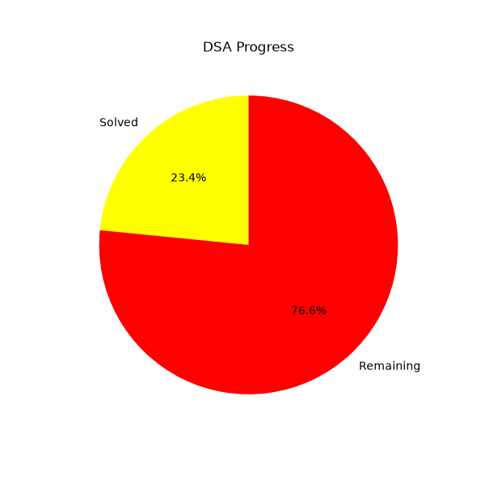

# 🕉️ Sri Yoganarasimha Swamy Prasanna 🦁

🚀 DSA Interview Preparation Tracker

## Progress

* Total Questions: **175**
* Solved: **52**
* Remaining: **123**

---

## Progress Chart

# Arrays (18)

- [x] Two Sum
- [x] Contains Duplicate
- [x] Best Time to Buy and Sell Stock
- [x] Maximum Subarray Sum
- [x] Product of Array Except Self
- [x] Maximum Product Subarray
- [x] Move Zeroes
- [x] Merge Sorted Array
- [x] Majority Element
- [x] Rotate Array
- [x] Find the Duplicate Number
- [x] Missing Number
- [x] Subarray Sum Equals K
- [x] Longest Consecutive Sequence
- [x] Maximum Subarray Sum with One Deletion
- [x] Sort Colors
- [x] Set Matrix Zeroes
- [x] Spiral Matrix

# Strings + Hashing (15)

- [x] Valid Anagram
- [x] Valid Palindrome
- [x] First Unique Character in a String
- [x] Ransom Note
- [x] Group Anagrams
- [x] Longest Substring Without Repeating Characters
- [x] Longest Palindromic Substring
- [x] Palindromic Substrings
- [x] Isomorphic Strings
- [x] Word Pattern
- [x] Longest Common Prefix
- [x] String Compression
- [x] Encode and Decode Strings
- [x] Minimum Window Substring
- [x] Find All Anagrams in a String

# Two Pointers (8)

- [x] Two Sum II
- [x] 3Sum
- [x] 3Sum Closest
- [x] Container With Most Water
- [x] Valid Palindrome
- [x] Remove Duplicates from Sorted Array
- [x] Squares of a Sorted Array
- [x] Trapping Rain Water

# Sliding Window (10)

- [x] Maximum Average Subarray I
- [x] Maximum Number of Vowels in a Substring
- [x] Longest Substring Without Repeating Characters
- [x] Longest Repeating Character Replacement
- [x] Permutation in String
- [x] Find All Anagrams in a String
- [x] Minimum Window Substring
- [ ] Longest Subarray of 1's After Deleting One Element
- [x] Fruit Into Baskets
- [x] Minimum Size Subarray Sum

# Binary Search (10)

- [x] Binary Search
- [ ] Search Insert Position
- [ ] First Bad Version
- [ ] Find First and Last Position
- [ ] Search in Rotated Sorted Array
- [ ] Find Minimum in Rotated Sorted Array
- [ ] Search a 2D Matrix
- [ ] Koko Eating Bananas
- [ ] Capacity To Ship Packages Within D Days
- [ ] Median of Two Sorted Arrays

# Linked List (11)

- [ ] Reverse Linked List
- [ ] Merge Two Sorted Lists
- [ ] Linked List Cycle
- [ ] Linked List Cycle II
- [ ] Remove Nth Node From End
- [ ] Middle of Linked List
- [ ] Reorder List
- [ ] Add Two Numbers
- [ ] Copy List with Random Pointer
- [ ] Merge k Sorted Lists
- [ ] Reverse Nodes in K-Group

# Stack / Monotonic Stack (10)

- [ ] Valid Parentheses
- [ ] Min Stack
- [ ] Evaluate Reverse Polish Notation
- [ ] Daily Temperatures
- [ ] Next Greater Element I
- [ ] Next Greater Element II
- [ ] Largest Rectangle in Histogram
- [ ] Car Fleet
- [ ] Simplify Path
- [ ] Asteroid Collision

# Queue / Deque (5)

- [ ] Implement Queue using Stacks
- [ ] Implement Stack using Queues
- [ ] Number of Recent Calls
- [ ] Design Circular Queue
- [ ] Sliding Window Maximum

# Intervals (8)

- [ ] Merge Intervals
- [ ] Insert Interval
- [ ] Non-overlapping Intervals
- [ ] Meeting Rooms
- [ ] Meeting Rooms II
- [ ] Minimum Number of Arrows
- [ ] Interval List Intersections
- [ ] Employee Free Time

# Trees / BST (16)

- [ ] Maximum Depth of Binary Tree
- [ ] Same Tree
- [ ] Invert Binary Tree
- [ ] Binary Tree Inorder Traversal
- [ ] Binary Tree Preorder Traversal
- [ ] Binary Tree Level Order Traversal
- [ ] Diameter of Binary Tree
- [ ] Balanced Binary Tree
- [ ] Path Sum
- [ ] Lowest Common Ancestor
- [ ] Validate BST
- [ ] Kth Smallest Element in BST
- [ ] Binary Tree Right Side View
- [ ] Construct Binary Tree (Preorder + Inorder)
- [ ] Binary Tree Maximum Path Sum
- [ ] Serialize and Deserialize Binary Tree

# Heap / Priority Queue (8)

- [ ] Kth Largest Element
- [ ] Last Stone Weight
- [ ] K Closest Points to Origin
- [ ] Top K Frequent Elements
- [ ] Find Median from Data Stream
- [ ] Kth Largest Element in a Stream
- [ ] Task Scheduler
- [ ] Reorganize String

# Graphs (18)

- [ ] Number of Islands
- [ ] Flood Fill
- [ ] Clone Graph
- [ ] Max Area of Island
- [ ] Pacific Atlantic Water Flow
- [ ] Rotting Oranges
- [ ] Course Schedule
- [ ] Course Schedule II
- [ ] Connected Components
- [ ] Graph Valid Tree
- [ ] Word Ladder
- [ ] Network Delay Time
- [ ] Cheapest Flights Within K Stops
- [ ] Accounts Merge
- [ ] Redundant Connection
- [ ] Is Graph Bipartite?
- [ ] Number of Connected Components using Union Find
- [ ] Minimum Spanning Tree (Kruskal's / Prim's)

# Backtracking (8)

- [ ] Subsets
- [ ] Subsets II
- [ ] Permutations
- [ ] Combination Sum
- [ ] Combination Sum II
- [ ] Letter Combinations of Phone Number
- [ ] Word Search
- [ ] Palindrome Partitioning

# Greedy (7)

- [ ] Best Time to Buy and Sell Stock II
- [ ] Jump Game
- [ ] Jump Game II
- [ ] Gas Station
- [ ] Partition Labels
- [ ] Assign Cookies
- [ ] Non-overlapping Intervals

# Dynamic Programming (16)

- [x] Climbing Stairs
- [ ] House Robber
- [ ] House Robber II
- [ ] Coin Change
- [ ] Maximum Product Subarray
- [ ] Longest Increasing Subsequence
- [ ] Longest Common Subsequence
- [ ] Word Break
- [ ] Partition Equal Subset Sum
- [ ] Decode Ways
- [ ] Unique Paths
- [ ] Combination Sum IV
- [ ] Edit Distance
- [ ] Longest Palindromic Subsequence
- [ ] Target Sum
- [ ] 0/1 Knapsack

# Bit Manipulation (5)

- [ ] Single Number
- [ ] Number of 1 Bits
- [ ] Counting Bits
- [ ] Reverse Bits
- [ ] Missing Number

# Trie (2)

- [ ] Implement Trie (Prefix Tree)
- [ ] Word Search II

---

## Study Plan & Time Estimates

**Total Time Required: ~190 hrs**

| Activity | Approx. Time |
| :--- | :--- |
| First attempt | ~105 hrs |
| Understanding solutions/hints | ~25 hrs |
| Re-solving difficult problems | ~25 hrs |
| Revision | ~20 hrs |
| Timed interview practice | ~15 hrs |

### Daily Commitments

*   **2 hours/day:** ~3–3.5 months
*   **3 hours/day:** ~2–2.5 months
*   **4 hours/day:** ~7–8 weeks